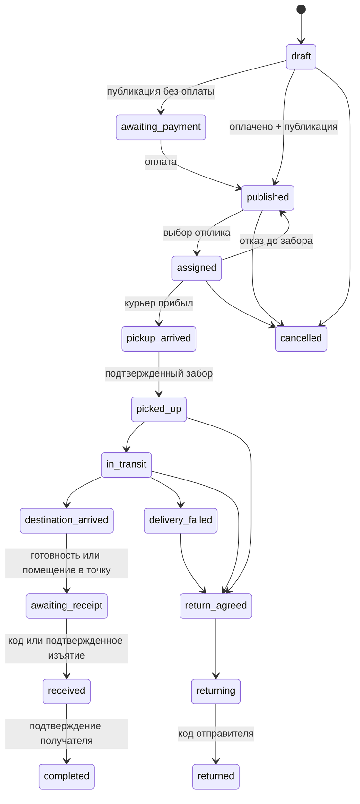

# Архитектура и допущения

Монолит Next.js 16 / React 19 / TypeScript, Node.js 24. Route Handlers выполняют аутентификацию, входную Zod-валидацию и вызывают доменные операции. PostgreSQL 17 — источник истины. S3-совместимое приватное хранилище держит фотографии; в базе только UUID и принадлежность. Браузер получает их через API с проверкой прав. Чат и состояния обновляются SSE с двухсекундной проверкой базы, реконнектом и ограниченным сроком подключения; это не брокер сообщений. При обрыве интерфейс сохраняет последнюю полученную карточку и явно показывает отсутствие соединения.

Доменные операции: `lib/service.ts`; транзакции: `lib/db.ts`; права и сессии: `lib/auth.ts`; провайдеры: `lib/providers.ts`; хранение фотографий: `lib/storage.ts`. SQL-миграции применяются последовательно и отмечаются в `schema_migrations`; advisory lock защищает от одновременного запуска мигратора.

Перед каждой операцией с заказом берется `SELECT … FOR UPDATE`. Проверка статуса, изменение статуса/ответственного, история передачи и аудит совершаются в одной транзакции. В назначениях дополнительно действует PK по заказу; БД запрещает назначать отправителя курьером. Idempotency-Key хранится вместе с действием и результатом; блокировка ключа предотвращает параллельные дубли. Внешний payment reference и shipment_id уникальны в оплате, выплате и возврате.

Неверная попытка кода возвращает прикладную ошибку внутри успешно зафиксированной транзакции: счетчик не откатывается вместе с исключением. Правильный код хеширован, привязан к заказу/этапу/выдающему участнику, истекает через пять минут и расходуется атомарно. Клиент не может присвоить статус вручную. Код не доступен в ленте, аудитах и уведомлениях.

## Состояния

Оплата, возврат денег, начисление/выплата и спор — независимые состояния. Открытие спора не двигает посылку и не меняет ответственного. После физического забора обычная отмена запрещена. При помещении в ячейку местонахождение становится ID точки, ответственность учета — за точкой, а не за получателем. Door-open не считается наличием: симулятор содержит отдельную команду deposit. Изъятие из ячейки и подтверждение завершения — отдельные операции.

## Модель

Users содержат UUID и публичный случайный ID, статусы личности и минимальный профиль. IdentityVerification хранит ссылку на результат провайдера, время, статус; паспорт/биометрия отсутствуют. Shipment связывает участников, состояния и условия тарифа. Parcel, Location, DeliveryLeg разделены для будущих нескольких посылок и участков. CourierOffer/Assignment фиксируют отклики/выбор. Handover/TrackingEvent обеспечивают историю ответственности. Payment/Refund/Payout отделены от доставки. Review/Dispute/Conversation/Message, Locker/Compartment/Reservation, Notification/AuditLog — отдельные таблицы.

Существенные условия заказа сейчас неизменяемы после создания. Это безопасное ограничение первой версии; повторное согласование изменений еще не реализовано. Все девять комбинаций типов точки используют один и тот же серверный процесс; пункты добавляют подтверждение ограниченного оператора через PointRequest. Аппаратные сообщения имеют event_id; поздний новый event не проходит проверку этапа, повтор принятого event не выполняется снова.

## Адаптеры

IdentityProvider возвращает проверенный сервером результат; реальный MyID должен заменить только адаптер, сохранив серверную проверку webhook/результата, привязку к пользовательской сессии и минимизацию данных. PaymentProvider не предполагает hold/split/P2P-payout; демо отражает бухгалтерский учет без реальных денег. MapsProvider явно возвращает `approximate=true`. NotificationProvider сейчас означает уведомления в БД, внешняя доставка не подключена. LockerProvider — явно обозначенный симулятор открытия, отдельные подтверждения физического действия остаются в доменной машине состояний.

Для масштабирования: outbox в той же транзакции + воркер доставки уведомлений/провайдерских операций, подписанный webhook с дедупликацией, Redis или PostgreSQL LISTEN/NOTIFY для SSE. Эти компоненты не нужны для локального демо и пока не реализованы. Для pilot потребуется надежная очередь внешних операций; сейчас внешних побочных эффектов нет.

## Порядок развития

1. Полный демонстрационный сквозной сценарий и серверные запреты, тесты, эксплуатационная документация.
2. Закрытый пилот внутри города: документированные MyID/SMS/платежные адаптеры, полная локализация, геокодирование и дорожная карта, юридическая/операционная проверка, внешний security review.
3. Только после приемки первого этапа — реальное оборудование, межгород, несколько посылок/участков и кабинет бизнеса.

Для низкоэнтропийных OTP/кодов передачи используются HMAC с приватным серверным ключом и привязкой к телефону либо заказу/этапу/участнику, а не один только перебираемый SHA256 шестизначного кода. Высокоэнтропийные токены сессий/приглашений хешируются. Replay-ответы с секретами дополнительно шифруются AES-256-GCM, а fingerprint тела запроса защищен HMAC; изменение тела под прежним Idempotency-Key отклоняется.
